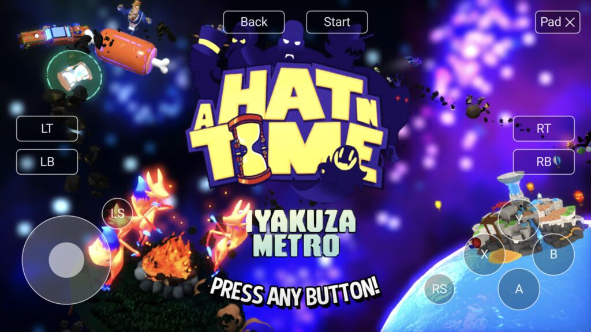
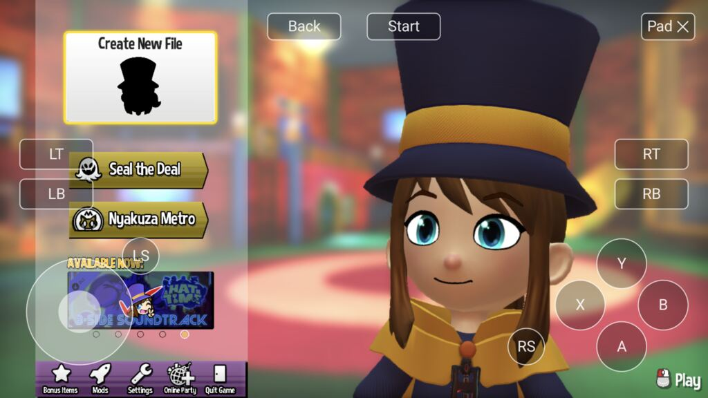
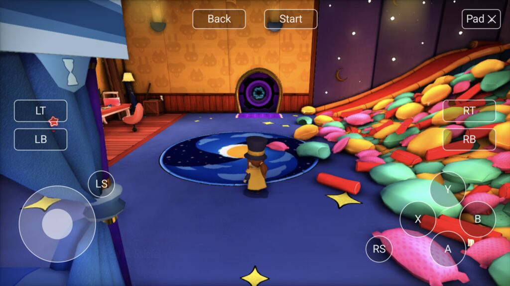

# A Hat in Time – Android-Port (selbst bauen)

Ein nativer Android-Port (`arm64-v8a`) der PC-Version von **A Hat in Time** (Unreal Engine 3, Win64,
Direct3D 9 SM3), umgesetzt als **statische Rekompilierung**: Der x86-64-Maschinencode von
`Binaries/Win64/HatinTimeGame.exe` (48.095 Funktionen) wird vorab nach C übersetzt und mit dem
Android NDK nativ für ARM64 kompiliert. Direct3D 9 läuft über DXVK Native auf Vulkan 1.1, Audio über
einen nativen XAudio2.7- + `stb_vorbis`-Mixer auf SDL3 und die Paket-Dekomprimierung über einen
nativen LZO1X-Override — kein Emulator, kein Wine, kein Box64.

**Hier gibt es keine fertige APK und keine Dateien aus dem Spiel.** Du baust die APK selbst aus
**deiner eigenen**, legal erworbenen PC-Version: Der Build übersetzt deine `HatinTimeGame.exe` lokal
auf deinem Rechner. Dieses Repository enthält ausschließlich eigenen Runtime-Code, Tools, DXVK-Patches
und Lift-Einstellungen (keinen Spielcode, keine Assets). Die App importiert die Spieldaten (`Engine/`,
`HatinTimeGame/`) von deiner Kopie auf dem Gerät. Die erzeugte APK enthält aus deiner EXE
rekompilierten Code und ist nur für dich selbst bestimmt, nicht zum Weitergeben. A Hat in Time ist
© Gears for Breakfast; dieses Projekt steht in keiner Verbindung zum Hersteller.

*English version: [README.md](README.md)*

## Screenshots

<table>
  <tr>
    <td width="50%"><br><sub>3D-Titelbildschirm (inkl. Seal the Deal &amp; Nyakuza Metro) auf dem AYN Odin 3, 60 fps</sub></td>
    <td width="50%"><br><sub>Spielstand-Auswahl mit 3D-Bokeh-Tiefenschärfe, 60 fps</sub></td>
  </tr>
  <tr>
    <td colspan="2" align="center"><br><sub>Raumschiff-3D-Gameplay auf dem AYN Odin 3 (1280×720), stabile 60 fps</sub></td>
  </tr>
</table>

## Status

Spielbar. Auf echter Android-Hardware verifiziert: Boot, Gears-for-Breakfast-Intro, 3D-Titelbildschirm
(inkl. *Seal the Deal* & *Nyakuza Metro*), Spielstand-Auswahl, neues Savegame (`slot1.hat`),
Raumschiff-3D-Gameplay (Laufen, Springen, Kamera), XAudio2- + Ogg-Vorbis-Audio, physischer Controller +
On-Screen-Pad, ZIP64-Datenimport sowie Background/Resume (gleiche PID, persistenter Adreno-`VkPipelineCache`).
Technisches Protokoll: [`port/RECOMP_STATUS.md`](port/RECOMP_STATUS.md).

| Gerät | GPU | Auflösung | Ergebnis |
|---|---|---|---|
| AYN Odin 3 (Android 15, Snapdragon 8 Elite) | Adreno 830 | 1280×720 | **59,6–60,0 fps** (`p50 = 16,6–17,1 ms`, 0 Frames ≥ 30 ms im Steady-State) |

Voraussetzungen: arm64-Android 10+ (API 29+), Vulkan 1.1, **ab ca. 8 GB RAM** (`2,7 GB` PSS im Titel/Menü,
`4,5 GB` PSS im Raumschiff), ca. 8 GB freier Speicher für die Spieldaten. Verifiziert auf Adreno;
Mali-/Xclipse-GPUs sind ungetestet.

## Voraussetzungen für den Build

- Deine eigene PC-Installation von **A Hat in Time** (Win64) mit genau dieser EXE:
  `Binaries/Win64/HatinTimeGame.exe` — SHA-256
  `0197f98641c2150c5e90e5e911f4464e38527c241e50817736ca7072c0b99892`
  (andere Versionen benötigen ggf. angepasste Lift- und Override-Adressen).
- **Docker** (Linux, macOS oder Windows mit WSL2), **≥ 16 GB RAM**, **ca. 25 GB freier Speicher** und
  Internetzugang (Android SDK/NDK und gepinnte Drittanbieter-Quellen werden beim Build geladen).

## Build

```sh
git clone https://github.com/zwaetschge/hatintime-android.git
cd hatintime-android
./build.sh "/pfad/zu/A Hat in Time"
# oder direkt mit der EXE:
./build.sh "/pfad/zu/A Hat in Time/Binaries/Win64/HatinTimeGame.exe"
```

Ergebnis: `out/HatInTime-Android-<version>.apk` (ca. 27 MB).

Was `./build.sh` ausführt (in Docker über `docker/Dockerfile` und `tools/build.sh`):

1. Prüft die SHA-256-Prüfsumme deiner `HatinTimeGame.exe`.
2. Lädt die gepinnten Drittanbieter-Quellen (`tools/fetch_deps.sh`): `pcrecomp` (+ `tools/patches/pcrecomp-hatintime.patch`), `dxvk-native` `native-1.9.2b`, `SDL 3.2.12` und `stb_vorbis.c` v1.22.
3. Katalogisiert `.pdata` und liftet `HatinTimeGame.exe` in 126 C-Dateien unter `gen/` (bleibt lokal).
4. Bereitet DXVK Native D3D9 für Android vor (`gfx/dxvk/prepare.py`) und kompiliert die 54 internen Vulkan-1.1-Shader (`gfx/dxvk/shaders.py`).
5. Kompiliert `libmain.so` + `libSDL3.so` für `arm64-v8a` mit dem Android NDK (`-O2 -march=armv8.2-a`).
6. Baut und signiert `out/HatInTime-Android-<version>.apk` per Gradle (erzeugt automatisch einen wiederverwendbaren Keystore in `work/release.keystore`, oder nutzt `HAT_KEYSTORE*`).

Wenig RAM? Mit `JOBS=4 ./build.sh ...` begrenzt du die parallelen Compiler. Auf Linux ohne Docker genügen die Pakete aus `docker/Dockerfile` und direkt `sh tools/build.sh ...`.

## Installieren & Spielen

1. APK installieren: `adb install -r out/HatInTime-Android-<version>.apk`
2. Eigene PC-Spieldaten importieren (ca. 7,4 GB: `Binaries/Win64/HatinTimeGame.exe`, `Engine/`, `HatinTimeGame/`):
   - App starten und über **„Ordner wählen“** den Spielordner auswählen, **oder**
   - den Spielordner als ZIP/ZIP64 packen und über **„Datenpaket (ZIP) wählen“** entpacken (oder in `Android/obb/ch.plum.hatintime/` ablegen, dann wird er automatisch entpackt), **oder**
   - per USB/ADB nach `Android/data/ch.plum.hatintime/files/game/` kopieren.
3. **„Spielen“** tippen.

### Steuerung & Optionen
- **Physischer Controller** (Handheld-Steuerung, Bluetooth, USB): direkt als XInput-Controller 0 gebunden.
- **On-Screen-Pad (`PadView`)**: linker Stick, `A`/`B`/`X`/`Y`, `LB`/`RB`/`LT`/`RT`, `LS`/`RS`, `Back`/`Start`, Wischen rechts dreht die Kamera, kurzes Tippen klickt im Menü, **`Pad ✕`** oben rechts blendet das Pad aus/ein.
- **Auflösung**: standardmäßig 1280 px Breite (z. B. `1280×720`, vom Android-Compositor skaliert) für stabile 60 fps; im Launcher optional **„Volle Bildschirmauflösung“** aktivierbar.
- **Spielstände & Caches**: Logs und Shader-/Pipeline-Caches liegen unter `Android/data/ch.plum.hatintime/files/user/`; Spielstände (`slot1.hat`, …) unter `<Spielordner>/HatinTimeGame/SaveData/`.

## Bekannte Einschränkungen

- **Online Party / Steam Workshop / Steam Cloud** sind offline gestubbt (`runtime/src/steam.c`); Singleplayer und DLCs laufen vollständig offline.
- Bisher nur auf **Adreno (Adreno 830)** getestet; Mali-/Xclipse-GPUs sind ungetestet.

## Lizenz

Der Code in diesem Repository steht unter der **MIT-Lizenz** ([`LICENSE`](LICENSE)). Alle eingebundenen bzw. beim Build geladenen Drittanbieter-Komponenten stehen in [`THIRD_PARTY_NOTICES.md`](THIRD_PARTY_NOTICES.md). **A Hat in Time**, dessen Code und Spieldaten sind nicht Bestandteil dieses Repositories und bleiben Eigentum von Gears for Breakfast.
