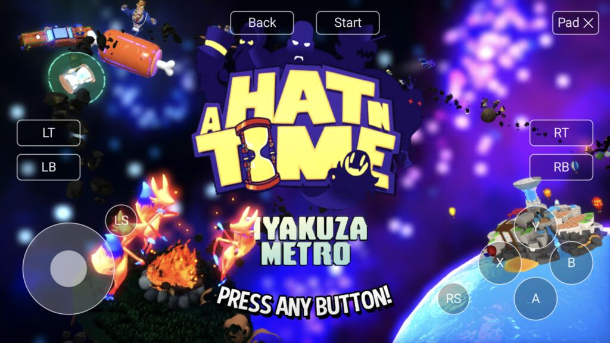
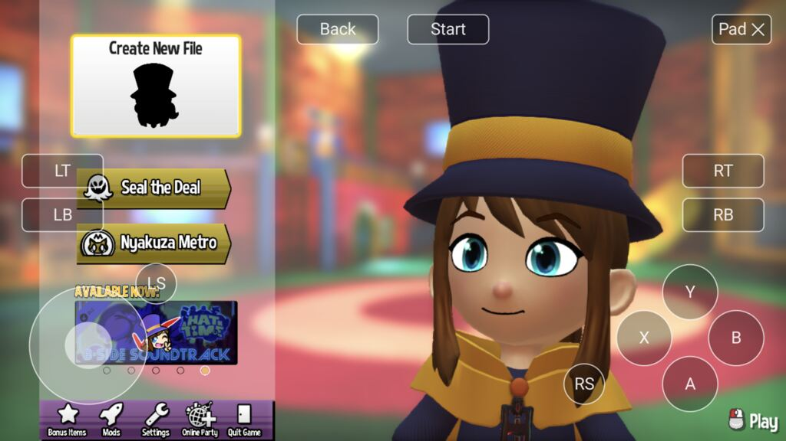
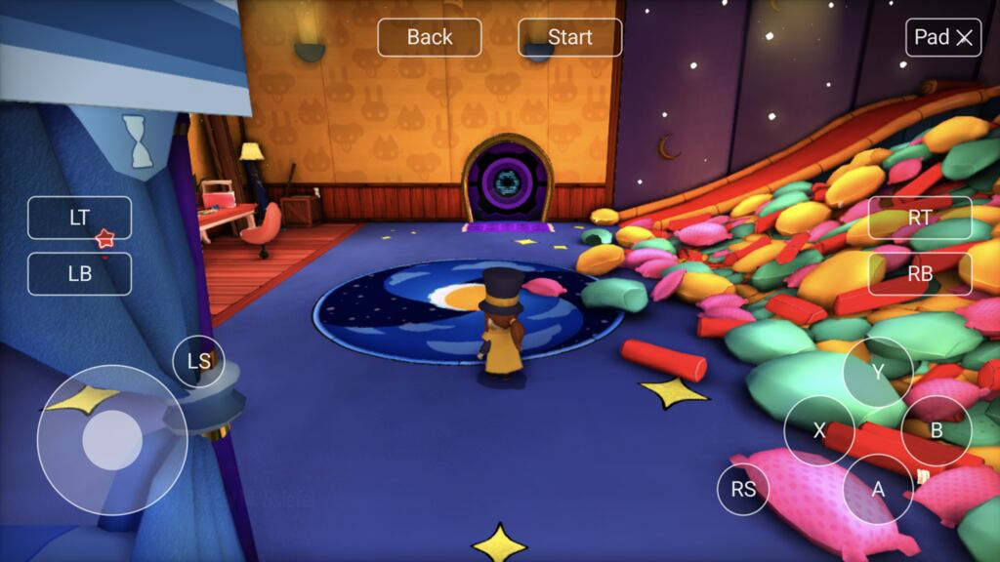

# A Hat in Time – Android port (build it yourself)

An Android (arm64) port of the PC version of **A Hat in Time** (Unreal Engine 3, Win64, Direct3D 9 SM3),
made by **statically recompiling** `Binaries/Win64/HatinTimeGame.exe`: the x86-64 machine code
(48,095 functions) is translated to C ahead of time and compiled natively for ARM64 with the Android NDK.
Direct3D 9 runs on Vulkan 1.1 through DXVK Native, audio runs through a native XAudio2.7 + `stb_vorbis`
mixer on SDL3, and package decompression uses a native C LZO1X override — no emulator, no Wine, no Box64.

**There is no prebuilt APK here and nothing from the game.** You build the APK yourself from **your own**
legally acquired PC copy: the build translates your `HatinTimeGame.exe` on your machine. This repository
only holds original runtime code, tools, DXVK patches, and per-build lift settings (no game code or assets).
The app imports the game data (`Engine/`, `HatinTimeGame/`) from your copy on the device. The APK you build
contains code recompiled from your EXE, so it is for you only, not for sharing. A Hat in Time is © Gears
for Breakfast; this project is not affiliated with or endorsed by them.

*Deutsche Version: [README.de.md](README.de.md)*

## Screenshots

<table>
  <tr>
    <td width="50%"><br><sub>3D title screen (incl. Seal the Deal &amp; Nyakuza Metro) on AYN Odin 3, 60 fps</sub></td>
    <td width="50%"><br><sub>File select menu with 3D bokeh depth-of-field, 60 fps</sub></td>
  </tr>
  <tr>
    <td colspan="2" align="center"><br><sub>Spaceship 3D gameplay on AYN Odin 3 (1280×720), steady 60 fps</sub></td>
  </tr>
</table>

## Status

Playable. Verified end-to-end on real Android hardware: boot, Gears for Breakfast intro, 3D title screen
(incl. *Seal the Deal* & *Nyakuza Metro*), file select, creating and saving a file (`slot1.hat`), Spaceship
3D gameplay (walking, jumping, camera), XAudio2 + Ogg Vorbis audio, physical controller + on-screen pad,
ZIP64 data import, and background/resume (same PID, persistent Adreno `VkPipelineCache`).
Full technical ledger: [`port/RECOMP_STATUS.md`](port/RECOMP_STATUS.md).

| Device | GPU | Resolution | Result |
|---|---|---|---|
| AYN Odin 3 (Android 15, Snapdragon 8 Elite) | Adreno 830 | 1280×720 | **59.6–60.0 fps** (`p50 = 16.6–17.1 ms`, 0 frames ≥ 30 ms steady-state) |

Requirements: arm64 Android 10+ (API 29+), Vulkan 1.1, **~8 GB RAM or more** (`2.7 GB` PSS in title/menu,
`4.5 GB` PSS in Spaceship), ~8 GB free storage for the game data. Adreno GPUs are verified; Mali/Xclipse
GPUs are untested.

## What you need to build

- Your own PC copy of **A Hat in Time** (Win64), matching this executable:
  `Binaries/Win64/HatinTimeGame.exe` — SHA-256
  `0197f98641c2150c5e90e5e911f4464e38527c241e50817736ca7072c0b99892`
  (other builds will likely need updated lift settings / override addresses).
- **Docker** (Linux, macOS, or Windows with WSL2), **≥ 16 GB RAM**, **~25 GB free disk**, and internet
  access (the build fetches the Android SDK/NDK and pinned third-party sources).

## Build

```sh
git clone https://github.com/zwaetschge/hatintime-android.git
cd hatintime-android
./build.sh "/path/to/A Hat in Time"
# or pass the EXE directly:
./build.sh "/path/to/A Hat in Time/Binaries/Win64/HatinTimeGame.exe"
```

Result: `out/HatInTime-Android-<version>.apk` (~27 MB).

What `./build.sh` does (in Docker via `docker/Dockerfile` and `tools/build.sh`):

1. Verifies the SHA-256 of your `HatinTimeGame.exe`.
2. Fetches pinned third-party sources (`tools/fetch_deps.sh`): `pcrecomp` (+ `tools/patches/pcrecomp-hatintime.patch`), `dxvk-native` `native-1.9.2b`, `SDL 3.2.12`, and `stb_vorbis.c` v1.22.
3. Catalogues `.pdata` entries and lifts `HatinTimeGame.exe` to 126 C translation units in `gen/` (stays local on your machine).
4. Prepares DXVK Native D3D9 for Android (`gfx/dxvk/prepare.py`) and compiles its 54 built-in Vulkan 1.1 shaders (`gfx/dxvk/shaders.py`).
5. Compiles `libmain.so` + `libSDL3.so` for `arm64-v8a` with the Android NDK (`-O2 -march=armv8.2-a`).
6. Builds and signs `out/HatInTime-Android-<version>.apk` with Gradle (auto-generating a reusable local keystore in `work/release.keystore`, or using `HAT_KEYSTORE*` if set).

Lower RAM? Use `JOBS=4 ./build.sh ...`. On Linux without Docker, install the packages from `docker/Dockerfile` and run `sh tools/build.sh ...` directly.

## Install and play

1. Install the APK: `adb install -r out/HatInTime-Android-<version>.apk`
2. Import your PC game data (~7.4 GB: `Binaries/Win64/HatinTimeGame.exe`, `Engine/`, `HatinTimeGame/`):
   - Launch **A Hat in Time** and tap **"Ordner wählen"** to pick your game folder via Android's folder picker, **or**
   - Pack the game folder into a ZIP/ZIP64 archive and pick it with **"Datenpaket (ZIP) wählen"** (or place it in `Android/obb/ch.plum.hatintime/` for automatic unpacking), **or**
   - Copy the files via USB/ADB into `Android/data/ch.plum.hatintime/files/game/`.
3. Tap **"Spielen"**.

### Controls & options
- **Physical gamepad** (built-in handheld controls, Bluetooth, or USB): mapped directly to XInput pad 0.
- **On-screen pad (`PadView`)**: left stick, `A`/`B`/`X`/`Y`, `LB`/`RB`/`LT`/`RT`, `LS`/`RS`, `Back`/`Start`, right-half drag for camera look, short taps for menu clicks, and a **`Pad ✕`** toggle in the top-right corner.
- **Resolution**: defaults to 1280 px width (e.g. `1280×720`, hardware-scaled by Android's compositor) for locked 60 fps; enable **"Volle Bildschirmauflösung"** in the launcher for native display resolution.
- **Saves & cache**: user logs and shader/pipeline caches live in `Android/data/ch.plum.hatintime/files/user/`; game saves (`slot1.hat`, …) live in `<game dir>/HatinTimeGame/SaveData/`.

## Known limitations

- **Online Party / Steam Workshop / Steam Cloud** are offline-stubbed (`runtime/src/steam.c`); single-player story and DLCs work offline.
- **Only Adreno GPUs (Adreno 830)** have been tested so far; Mali/Xclipse GPUs are untested.

## How it works

- **Lift** (`tools/lift_module.sh`, `tools/directcalls.py`, `tools/shadowcpu.py`): `pcrecomp`'s `generate64` lifts all 48,095 functions of `HatinTimeGame.exe` into C with zero lift errors, rewrites internal calls to direct C calls (keeping `0x140001050` dispatched via `config/keep_dispatch_HatinTimeGame.txt`), and shadows the CPU struct into locals.
- **Win64 Runtime** (`runtime/src/`): PE loader at `0x140000000`, Win64 SEH/C++ exceptions (`eh64.c`), UCRT/`VCRUNTIME140`/`MSVCP140`/`tbbmalloc` (`ucrt.c`), Win32/UE3 APIs (`hat_win32.c`, `k32_*.c`, `user32.c`, `win_*.c`), offline Steam stub (`steam.c`, AppID `253230`), XInput (`xinput.c`), and a native C `lzo1x_decompress_safe` override (`lzo1x_native.c`, ~5× faster startup).
- **Graphics** (`gfx/hat_d3d9.cpp`, `gfx/dxvk/`, `runtime/src/native_call.c`): Direct3D 9 SM3 over DXVK Native 1.9.2b (`src/d3d9` + `src/dxso` + `src/dxvk`), persistent Adreno `VkPipelineCache`, lock-free `dxvk-async` pipeline compilation, Android swapchain lifecycle handling (`hp_wsi.cpp`), and AArch64 C++ member-pointer ABI classification.
- **Audio** (`runtime/src/xaudio2.c`, `runtime/src/vorbis.c`): native XAudio2.7 COM mixer + `stb_vorbis` Ogg Vorbis decoding outputting 48 kHz stereo to SDL3.
- **Android app** (`android/`): `Launcher` (SAF folder + `FileChannel` ZIP64 importer), `HatActivity` (`SDLActivity`), and `PadView`.

## Development

A Linux headless debug host (`Xvfb` + Mesa `lavapipe`) runs the exact same runtime and lifted code:

```sh
sh tools/build_dxvk.sh host
sh tools/build_host.sh
sh tools/hostrun_gfx.sh boot 60
```

See [`AGENTS.md`](AGENTS.md) for debug environment variables (`W64_TRACE`, `HP_STUTTER`, `HAT_LZO_VERIFY`, `HP_DXVK_LOG`) and [`port/RECOMP_STATUS.md`](port/RECOMP_STATUS.md) for the full port log.

## License

The code in this repository is MIT licensed (see [`LICENSE`](LICENSE)). Third-party components and their
licenses are listed in [`THIRD_PARTY_NOTICES.md`](THIRD_PARTY_NOTICES.md). **A Hat in Time**, its code,
and its assets are not covered and remain the property of Gears for Breakfast.
